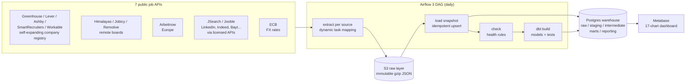
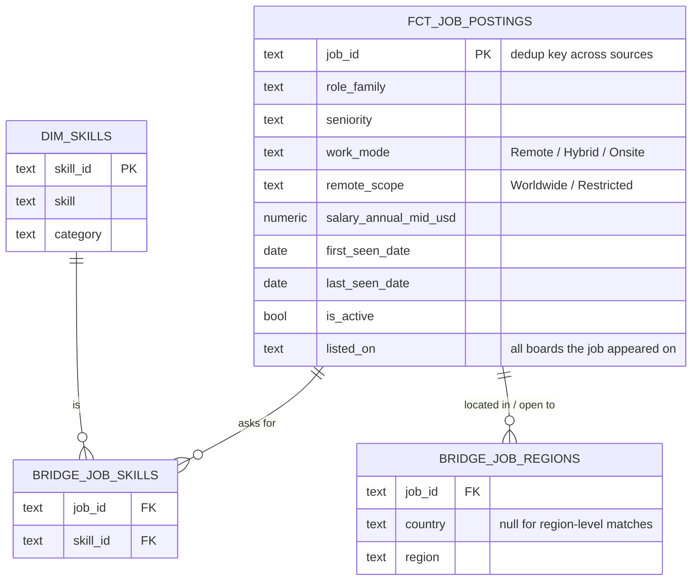

# Data Job Market Radar

**Which data jobs can I actually get from where I live, what should I learn next, and what do they pay?**

An end-to-end data engineering project that collects ~1,000 data engineering, analytics, BI and data science
job postings every day from 9 public and licensed sources, models them with dbt, and answers those questions in a
self-service dashboard, from the point of view of *one specific person* (their country, role and skills).


---

## Why this project

Job boards answer "what jobs exist?". Job seekers need different answers:

| Question | How the project answers it |
|---|---|
| *"Remote" — but remote for whom?* | Parses each remote job's eligibility (worldwide / region / country lists) and matches it to the viewer's country. In the data, only a small fraction of remote data jobs are open worldwide. |
| *What should I learn next?* | Extracts 73 skills from every description; given the skills you already have, ranks the skill that would make you match the most additional jobs. |
| *Where are the jobs?* | Office location (onsite/hybrid) and remote eligibility mapped to countries and regions. |
| *What does it pay?* | Salaries in any period/currency normalized to annual USD and EUR with daily ECB exchange rates. |
| *Is demand rising or falling?* | Daily snapshots give skill trends and how long each job stays open. |

## Architecture



| Layer | Tech | Notes |
|---|---|---|
| Orchestration | **Apache Airflow 3.3** (LocalExecutor) | TaskFlow API, dynamic task mapping (one task per source), retries, idempotent reruns |
| Raw layer | **S3-compatible object storage** (SeaweedFS) | Untouched API responses, partitioned `source=/snapshot_date=`; loads are replayable from here |
| Warehouse | **PostgreSQL 16** | Daily snapshot table (grain: source × job × day) + ingestion log |
| Transformation | **dbt 1.12** | 28 models, 51 data tests, 4 seeds; staging → intermediate → marts → reporting |
| BI | **Metabase** | Dashboard built from code via its REST API (`scripts/setup_metabase.py`) |
| Packaging | **Docker Compose** | One command brings up the whole stack on a laptop |

## Data model



dbt layers: `staging` (one model per source, all with identical columns) → `intermediate`
(union → classify → geo → job key → dedup → salary) → `marts` (fact + bridges + dim) →
`reporting` (small dashboard-ready aggregates) and `monitoring` (what the rules missed).

## Engineering decisions worth discussing

1. **Raw layer first, always.** Every API response lands untouched in object storage before
   anything parses it. Parsing rules changed many times during development (role rules, skill
   patterns, salary handling); history was simply rebuilt with `dbt build`, never re-fetched.
2. **Daily snapshots instead of "current state".** The raw table's grain is *source × job × day*.
   From that, dbt derives `first_seen`, `last_seen`, `days_listed` and `is_active` for every job,
   and skill trends over time, information no source provides directly.
3. **Activity is judged per source.** A job is active if it appeared in its *own source's* latest
   snapshot, so one failed source doesn't mark its jobs as closed.
4. **Cross-source dedup with a survivor rule.** The same job appears on a company board and on
   aggregators. A normalized key (company + title without gender markers like *(m/w/d)* + work
   mode + country) groups listings; the richest source survives, but **attributes are merged**:
   a tested bug fix takes the salary from whichever listing has one.
5. **Remote eligibility is a first-class field.** Free-text eligibility ("Remote within Germany",
   "EMEA", "USA only", empty = worldwide) is mapped through an editable regex seed
   (~100 patterns, 90+ countries, multi-region mappings like EMEA → Europe + MENA + Africa).
6. **Rules live in seeds, not code.** Skills (73 regexes), locations, salary periods and country
   codes are CSV seeds. A `monitoring` schema lists unmatched locations and unclassified titles,
   which drove several tuning rounds on real data (e.g. role coverage went from ~76% to ~95%).
7. **Salaries normalized honestly.** Period labels ("1 YEAR", "per-month-salary", "hourly", ...)
   → annual; currency → EUR/USD at the ECB rate of the day the job was first seen; implausible
   values flagged, not deleted. The dashboard states that posted salaries are mostly US.
8. **Failure handling is deliberate.** Required sources fail the run if they return nothing;
   optional ones (a source whose free API shrank to a sample) only warn; a failed company board
   is logged as a warning; FX fetch failure falls back to the last known rates.
9. **A source catalog that grows itself.** Jobs found on aggregators often link to a company's
   Greenhouse/Lever/Ashby/SmartRecruiters/Workable board. A `discover_boards` task harvests those board names from raw
   payloads (regex in SQL), a `sync_boards` task validates new candidates with one request each,
   and working boards join the daily extract; boards failing 3 runs in a row are retired.
   Status lives in `raw.company_boards`, with a monitoring view in dbt.
10. **Dashboard as code.** The Metabase dashboard (17 charts, 4 filters) is created through the
   REST API, idempotently, so it is versioned and reproducible like the rest of the pipeline.

More detail: [docs/design-decisions.md](docs/design-decisions.md).

## Data sources

| Source | What it adds | Usage notes |
|---|---|---|
| Greenhouse, Lever, Ashby, SmartRecruiters, Workable public job boards | Company career pages: full descriptions; Lever/Ashby/SmartRecruiters state work mode and often salary | **Self-expanding registry**: ~100 seeds in `dags/jobradar/company_boards.csv`, plus boards discovered automatically from other sources' apply links |
| Himalayas | Remote jobs with country and timezone restrictions | Links back to Himalayas kept; no re-posting |
| Jobicy | Remote jobs with eligibility, level and salary | Polled once a day; source URL kept |
| Arbeitnow | European jobs, onsite and remote | Newest pages each day |
| Remotive | Remote jobs (now a small sample feed) | Optional source |
| JSearch (OpenWeb Ninja) | Google for Jobs data: postings first published on LinkedIn, Indeed, Glassdoor, Bayt and company sites, searched by country (Egypt, UAE, Saudi Arabia, Qatar, Germany, Spain, UK) | API key; free plan 200 requests/month, so 6 rotating searches/day |
| Jooble | Aggregator incl. regional boards (e.g. Wuzzuf, NaukriGulf partners); short snippets | API key; 3 rotating searches/day |
| ECB | Daily euro reference exchange rates | Used for salary conversion only |

Only data-related titles are stored (English, German, French, Spanish and Dutch title patterns).
No site is scraped: boards without a public API (LinkedIn, Indeed, Wuzzuf, NaukriGulf) are reached
only through licensed aggregator APIs (JSearch, Jooble), which index part of their listings. Those two have small quotas, so each day runs the
next slice of a country x role search list; their jobs count as active for 10 days after last seen,
and they are excluded from day-to-day trend charts so the rotation doesn't distort trends.
Job content stays the property of the original boards; this project publishes aggregates and links.

## Quality and testing

- **51 dbt data tests**: uniqueness and not-null keys, accepted values for every classification,
  referential integrity between fact and bridges, job lifecycle sanity, unique skill matches.
- **37 Python unit tests**: title filtering (including multilingual and false-positive cases),
  every extractor's pagination/filtering/failure path with mocked HTTP, ECB XML parsing.
- **Dashboard queries tested**: every chart's SQL is rendered with and without each filter and
  executed against a test warehouse; the Metabase API calls are checked against Metabase's own
  request schemas.
- **CI** (GitHub Actions): unit tests, `dbt parse`, and Docker Compose validation on every push.

## Run it locally

Requirements: Docker Desktop (Windows/macOS) or Docker Engine (Linux), ~6 GB RAM for Docker.

```bash
cp .env.example .env            # Windows PowerShell: Copy-Item .env.example .env, then edit passwords
docker compose up -d --build    # Airflow, Postgres, SeaweedFS, Metabase
```

Then open Airflow at http://localhost:8080, trigger `job_radar_ingest`, and build the dashboard:

```bash
docker compose exec -T -e MB_ADMIN_EMAIL=you@example.com -e MB_ADMIN_PASSWORD=YourPassw0rd123 \
  airflow-scheduler python - < scripts/setup_metabase.py
```

Dashboard: http://localhost:3000. Full operating guide (Windows commands, manual dbt runs,
tuning the rules, troubleshooting): [docs/RUNBOOK.md](docs/RUNBOOK.md).

## Project structure

```
dags/
  job_radar_ingest.py        # the DAG: setup → extract[source] → load → check → dbt_build (+ fx_rates)
  jobradar/                  # sources, title filter, S3 raw layer, warehouse loader, ECB FX
dbt/
  models/staging/            # stg_<source>: one shape for all 7 sources
  models/intermediate/       # classify, geo, job key, dedup, salary
  models/marts/              # fct_job_postings, bridges, dim_skills
  models/reporting/          # dashboard-ready aggregates
  models/monitoring/         # what the rules missed
  seeds/                     # skills, geo patterns, salary periods, country codes
scripts/setup_metabase.py    # dashboard as code
infra/                       # Postgres init, S3 credentials (local dev)
tests/                       # Python unit tests
```

## Limitations and next steps

- Local job boards (e.g. LinkedIn, regional boards) have no free public API, so onsite coverage is
  strongest for the US and Europe; remote coverage is global.
- Rule-based classification is transparent and testable but not perfect; an LLM-based extractor
  benchmarked against these rules is a natural next step.
- Planned: Iceberg + PySpark for the silver layer as volume grows, and a public read-only dashboard.

## Author

**Moamen Moussa**, Data Engineer. Built with Airflow, dbt, PostgreSQL, S3-compatible storage
and Metabase.

License: [MIT](LICENSE).
