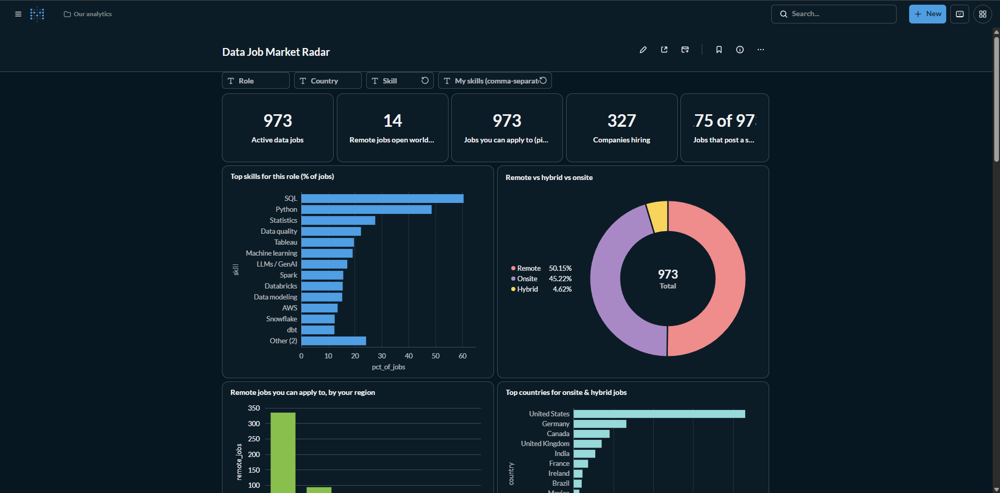
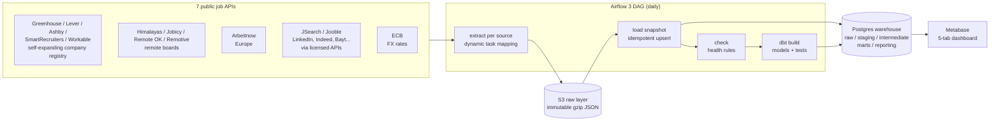
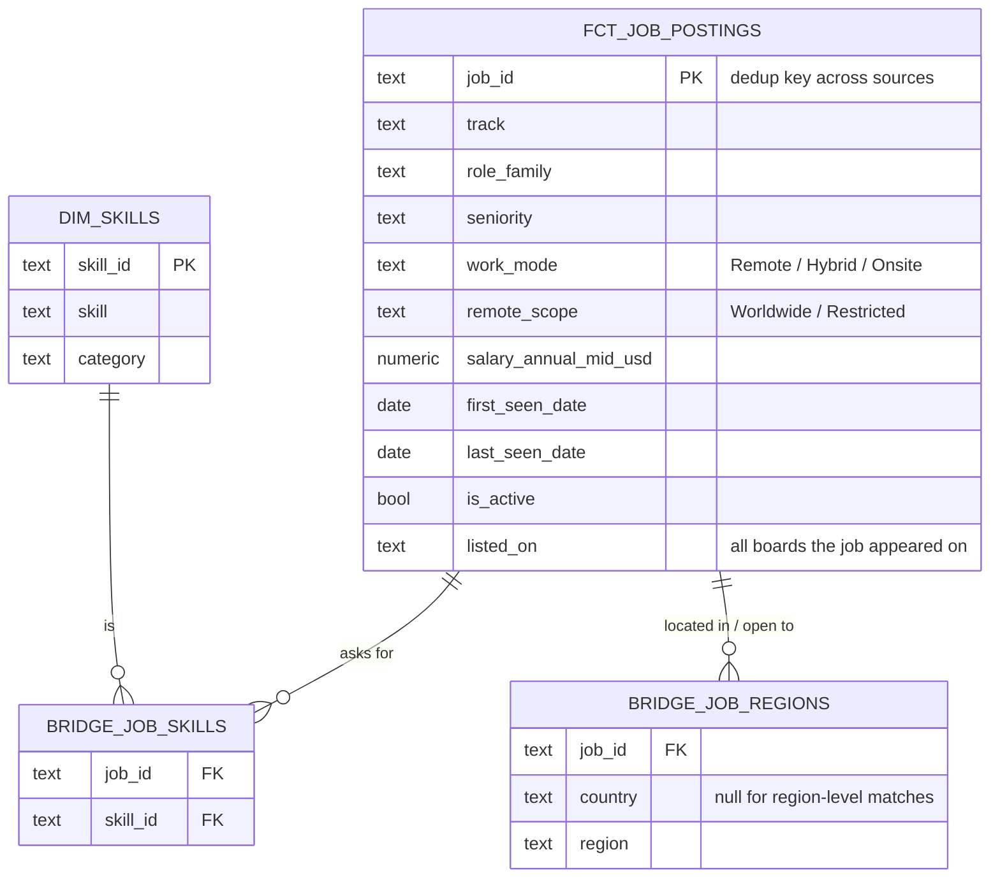

# Radarak (رادارك): your radar for tech jobs you can actually get

**Which tech jobs can I actually get from where I live, what should I learn next, and what do they pay?**

**Radarak** (Arabic for "your radar") is an end-to-end data engineering project that collects thousands of tech job postings every day (data & AI,
software, mobile (iOS, Android, Flutter), QA & testing, UI/UX design, DevOps & cloud, security, ERP, networks, product, IT) from 19 public and licensed sources, models them with dbt, and answers those questions in a
self-service dashboard, from the point of view of *one specific person* (their country, role and skills).

**Live site: https://radarak.online/** (Arabic + English, updated daily)




---

## Why this project

Job boards answer "what jobs exist?". Job seekers need different answers:

| Question | How the project answers it |
|---|---|
| *"Remote" — but remote for whom?* | Parses each remote job's eligibility (worldwide / region / country lists) and matches it to the viewer's country. In the data, only a small fraction of remote data jobs are open worldwide. |
| *What should I learn next?* | Extracts ~145 skills (languages, frameworks, testing, design, DevOps, data) from every description; given the skills you already have, ranks the skill that would make you match the most additional jobs. |
| *Where are the jobs?* | Office location (onsite/hybrid) and remote eligibility mapped to countries and regions. |
| *What does it pay?* | Salaries in any period/currency normalized to annual USD and EUR with daily ECB exchange rates. |
| *Is demand rising or falling?* | Daily snapshots give skill trends and how long each job stays open; "rising skills" compares jobs posted in the last 14 days with older ones. |
| *Which jobs should I apply to?* | Every job is scored against the skills you pick, with the skills you would still need to add. |

### The public website

`site/` is a static, mobile-first website in Arabic and English, published to GitHub Pages by the
pipeline's last task (`publish_site`). Visitors complete one sentence, "I live in [country] and I'm
looking for [role] jobs", and get the jobs they can apply to, with filters (seniority, work mode,
industry, must-have skill, Arabic, visa/relocation, hide nationals-only) and live insights: top skills,
the next skill to learn for *their* skills, pay by role, where the jobs are and who is hiring.
Visitors can **upload their CV** (PDF or Word) or paste its text: it is read in the browser (pdf.js and mammoth,
self-hosted) with the same skill rules the pipeline uses on job descriptions, and never leaves the device.
They get their skills, years of experience, likely role, best-matching jobs and "skills worth adding to your CV".
A **What to learn next** card picks the three skills that would add the most matching jobs, one after the other
("Airflow +85 jobs, then dbt +40...": a greedy plan over the jobs shown). Visitors can **save jobs and mark the
ones they applied to** (kept in the browser, with closed applications kept as history), see **what's new since
their last visit** (from each job's first-seen day), **share a job to WhatsApp** with a link that opens that job,
and **install the site as an app** (web manifest + a service worker that keeps the last copy for weak connections).
For search engines, every publish also writes **static pages per country, track and role** in English and Arabic
(`/jobs/egypt/data-engineer/`, `/ar/jobs/...`: `dags/jobradar/seo_pages.py`) with that day's jobs, top skills,
companies and pay, plus `sitemap.xml` and `robots.txt`. Thin pages are skipped (a role needs 5+ jobs in a place).
Jobs from company career sites also get **their own page with `JobPosting` structured data**, so they can show up
in Google's job search (`sitemap-jobs.xml`), and every country / track page has an **RSS feed** and a
"Join on Telegram" button for its channel.
Publishing reuses unchanged files by their git id and sends changed pages inline in a few batched requests, so
~2,000 files go up in about a dozen GitHub API calls.
It also writes **company pages** (`/companies/<name>/`, 3+ open jobs), a **juniors corner** (`/juniors/`) and a
**salary guide** (`/salaries/`, per place where 15+ jobs publish pay; a role needs 5+). **Radarak Weekly**
(`dags/jobradar/newsletter.py`) drafts or sends a Sunday email of the week's new jobs through Buttondown when
`BUTTONDOWN_API_KEY` is set; `BUTTONDOWN_USERNAME` switches on the subscribe box. Visitors can **report a closed
job** (it's hidden for them and counted in GoatCounter as `report-closed/<id>/<company>`).
A **Trends** tab shows how hiring changes week by week for the visitor's country (new jobs per week by
track, which tracks are hiring faster, skills on the rise and cooling down, how long jobs stay open), and
the **weekly report** page (`report.html`) turns last week into a shareable 1080×1350 image plus a ready
LinkedIn post, in Arabic or English, drawn in the browser.
Every morning the new jobs are also posted to **Telegram channels** (e.g. Egypt, the Gulf, Remote),
grouped by track with direct links (`dags/jobradar/telegram.py`, each job posted once).
All filtering happens in the browser on JSON files exported from the marts (`data/meta.json`, `data/trends.json`, and the
job list in two parts: `data/jobs.json` with every remote job and every job in the Middle East and Africa, loaded first so phones
stay fast, and `data/jobs-more.json` with the rest, loaded only when a visitor looks beyond those regions); links are shareable (filters live in the URL). Listings from sources that ask not to be
re-posted (Remotive, Himalayas) count in the statistics but are not listed; Adzuna/Jooble/JSearch/Jobicy/Remote OK
jobs carry their credit (Remote OK links are followed links, as its terms ask).

### The dashboard

Nine dropdown filters (Industry, Track, Role, Seniority, Work mode, Your country, Must-have skill, Requirements,
My skills) drive seven tabs, and clicking a bar (a track, role, skill, country, industry, ...) sets that filter:

| Tab | What it shows |
|---|---|
| 1. Market overview | Tech jobs by industry (banking, fintech, telecom, e-commerce, ...); active jobs, new this week, remote share, companies hiring, salary coverage and median; jobs by track and work mode; remote vs hybrid vs onsite; most in-demand roles; seniority mix; world map; top hiring companies; new postings per day; newest jobs (click a title to open the posting) |
| 2. Middle East | Jobs by country and track, nationals-only and Arabic-required shares, median salary, top roles and companies, and jobs abroad that offer visa sponsorship or relocation |
| 3. Skills to learn | Top skills and skill areas; next skill to learn for *your* skills; jobs you already match; how in demand your skills are; rising skills; skills that go together; daily skill trend |
| 4. Where to work | Remote vs hybrid vs onsite; remote jobs by who may apply; top countries; country comparison (jobs, hybrid share, junior jobs, median salary); original job boards |
| 5. Salary | 25th / median / 75th percentile; salary by role, seniority and country; best-paid skills |
| 6. Find jobs | Up to 500 jobs you can apply to, best skill match first, with salary and skills to add; click a title to open the posting |
| 7. Trends | New tech jobs per week by track (for your country), skill momentum, and how long jobs stay open by role |

## Architecture



| Layer | Tech | Notes |
|---|---|---|
| Orchestration | **Apache Airflow 3.3** (LocalExecutor) | TaskFlow API, dynamic task mapping (one task per source), retries, idempotent reruns |
| Raw layer | **S3-compatible object storage** (SeaweedFS) | Untouched API responses, partitioned `source=/snapshot_date=`; loads are replayable from here |
| Warehouse | **PostgreSQL 16** | Daily snapshot table (grain: source × job × day) + ingestion log |
| Transformation | **dbt 1.12** | 28 models, 51 data tests, 4 seeds; staging → intermediate → marts → reporting |
| BI | **Metabase** | Dashboard built from code via its REST API (`scripts/setup_metabase.py`) |
| Packaging | **Docker Compose** | One command brings up the whole stack on a laptop |

## Tracks and roles

Every job gets a **track** and a **role family** from rule-based title classification
(`dbt/models/intermediate/int_postings_classified.sql`); the role → track mapping is a seed
(`dbt/seeds/role_tracks.csv`) so it can be regrouped without code changes.

| Track | Role families |
|---|---|
| Data & Analytics | Data Engineer, Analytics Engineer, Data Analyst, BI, Data Scientist, Data Architect, Quantitative Analyst / Developer, Database Administrator, GIS Specialist, ... |
| AI & Machine Learning | ML / AI Engineer, MLOps Engineer, AI Research Scientist / Engineer, LLM / GenAI Engineer, Computer Vision Engineer, NLP / Speech Engineer |
| Software Engineering | Frontend, Backend, Full-Stack, Game / XR, Robotics, Blockchain, Software / Solutions Architect, Integration / API Engineer, Software Engineer, Engineering Leadership |
| Mobile Development | iOS Engineer, Android Engineer, Native Mobile Engineer (iOS + Android), Cross-platform (Flutter / React Native), Mobile Engineer |
| QA & Testing | QA Automation Engineer, QA / Test Engineer, Performance Test Engineer |
| UI/UX Design | UX / Product Designer, UI / Visual Designer, UX Researcher, UX Writer / Content Designer |
| DevOps & Cloud | DevOps / Platform, SRE, Cloud / Infrastructure |
| Security | Security Engineer, SOC / Security Analyst, Penetration Tester / Red Team, GRC / IT Audit, Identity & Access (IAM) |
| ERP & CRM | ERP / CRM Consultant, ERP / CRM Developer (SAP, Salesforce, Dynamics 365, Oracle apps, ServiceNow, Odoo), RPA / Low-code Developer (UiPath, OutSystems, Power Automate) |
| Networks & Telecom | Network Engineer, Telecom Engineer (RF, RAN, core network) |
| Product & Delivery | Product Manager / Owner, Technical Project / Program Manager, Scrum Master / Agile Coach, Developer Relations |
| IT & Support | IT Support / Sysadmin, Systems / IT Analyst, Solutions / Support Engineer, Technical Writer, Pre-sales / Sales Engineer, IT Leadership |
| Embedded & Chip Design | Embedded / Firmware Engineer, Automotive Software Engineer (AUTOSAR, ADAS), ASIC / FPGA Design Engineer, Design Verification Engineer (UVM, SystemVerilog) |

Each job also gets three signals read from its description (`int_job_signals`): **nationals only**
("Saudi nationals only", Emiratisation roles), **Arabic required**, and **visa sponsorship / relocation
offered** (explicit refusals such as "unable to sponsor" don't count).

## Data model



dbt layers: `staging` (one model per source, all with identical columns) → `intermediate`
(union → classify → geo → job key → dedup → salary) → `marts` (fact + bridges + dim) →
`reporting` (small dashboard-ready aggregates) and `monitoring` (what the rules missed).

## Engineering decisions worth discussing

1. **Raw layer first, always.** Every API response lands untouched in object storage before
   anything parses it. Parsing rules changed many times during development (role rules, skill
   patterns, salary handling); history was simply rebuilt with `dbt build`, never re-fetched.
2. **Daily snapshots instead of "current state".** The raw table's grain is *source × job × day*.
   From that, dbt derives `first_seen`, `last_seen`, `days_listed` and `is_active` for every job,
   and skill trends over time, information no source provides directly.
3. **Activity is judged per source.** A job is active if it appeared in its *own source's* latest
   snapshot, so one failed source doesn't mark its jobs as closed.
4. **Cross-source dedup with a survivor rule.** The same job appears on a company board and on
   aggregators. A normalized key (company + title without gender markers like *(m/w/d)* + work
   mode + country) groups listings; the richest source survives, but **attributes are merged**:
   a tested bug fix takes the salary from whichever listing has one.
5. **Remote eligibility is a first-class field.** Free-text eligibility ("Remote within Germany",
   "EMEA", "USA only", empty = worldwide) is mapped through an editable regex seed
   (~100 patterns, 90+ countries, multi-region mappings like EMEA → Europe + MENA + Africa).
6. **Rules live in seeds, not code.** Skills (73 regexes), locations, salary periods and country
   codes are CSV seeds. A `monitoring` schema lists unmatched locations and unclassified titles,
   which drove several tuning rounds on real data (e.g. role coverage went from ~76% to ~95%).
7. **Salaries normalized honestly.** Period labels ("1 YEAR", "per-month-salary", "hourly", ...)
   → annual; currency → EUR/USD at the ECB rate of the day the job was first seen; implausible
   values flagged, not deleted. The dashboard states that posted salaries are mostly US.
8. **Failure handling is deliberate.** Required sources fail the run if they return nothing;
   optional ones (a source whose free API shrank to a sample) only warn; a failed company board
   is logged as a warning; FX fetch failure falls back to the last known rates.
9. **A source catalog that grows itself.** Jobs found on aggregators often link to a company's
   Greenhouse/Lever/Ashby/SmartRecruiters/Workable board. A `discover_boards` task harvests those board names from raw
   payloads (regex in SQL), a `sync_boards` task validates new candidates with one request each,
   and working boards join the daily extract; boards failing 3 runs in a row are retired.
   Status lives in `raw.company_boards`, with a monitoring view in dbt.
10. **Dashboard as code.** The Metabase dashboard (6 tabs, 48 cards, 9 dropdown filters, click-to-filter) is created
   through the REST API, idempotently, so it is versioned and reproducible like the rest of the pipeline.

More detail: [docs/design-decisions.md](docs/design-decisions.md).

## Data sources

| Source | What it adds | Usage notes |
|---|---|---|
| Greenhouse (US and EU), Lever, Ashby, SmartRecruiters, Workable, Recruitee, Personio, Breezy, Teamtailor, BambooHR, Pinpoint public job boards | Company career pages: full descriptions; Lever/Ashby/SmartRecruiters/Recruitee state work mode and often salary | **Self-expanding registry**: seeds in `dags/jobradar/company_boards.csv`; ~1,000 companies in Egypt, the Gulf, Turkey, North Africa, the Levant, Iraq, South and Central Asia, the Caucasus, the Balkans, Africa and Europe in `dbt/seeds/companies.csv` whose hiring platform is detected automatically; plus boards discovered from other sources' apply links |
| Oracle Recruiting Cloud career sites (Emirates NBD, FAB, e&, Emaar, DP World, Mobily, ROSHN, ...) | Big Gulf banks, telcos and government-owned companies; read through the site's public job search (`recruitingCEJobRequisitions`) | Board ids `<host>/<site number>` in `company_boards.csv` |
| Phenom career sites (e.g. Orange, ADNOC, Majid Al Futtaim) | Large employers' own career sites; read through the site's public job search (`/widgets`), Egypt first | Board ids `<host>/<country>/<lang>?<Country>` in `company_boards.csv` |
| Workday and SAP SuccessFactors career sites | Large corporates and multinationals (banks, telcos, energy, pharma, tech) with offices in Egypt and the Gulf, which don't use the startup job boards above; Workday through its careers-site JSON API (only jobs in MENA and Europe are requested), SuccessFactors through its RSS job feed | Seeds with display names in `company_boards.csv`; more Workday boards are discovered automatically from apply links in other sources (`*.myworkdayjobs.com`) |
| Adzuna | Job search in all 19 Adzuna countries (UK, EU, India, South Africa, Singapore, Brazil, Mexico, US, Canada, Australia, NZ; 20 roles), short snippets; only real (not Adzuna-predicted) salaries are kept | API id + key; 80 rotating searches/day. Jobs by Adzuna |
| Bundesagentur für Arbeit | Germany's federal job agency (official public API): IT jobs across Germany; no descriptions, so no skills | Public key; 18 searches × up to 2 pages a day |
| Himalayas | Remote jobs with country and timezone restrictions | Links back to Himalayas kept; no re-posting |
| Jobicy | Remote jobs with eligibility, level and salary | Polled once a day; source URL kept |
| Remote OK | Public feed of the newest ~100 remote jobs | One request per run; each job links to its Remote OK page with a followed link and says "via Remote OK" (their terms); no logo |
| Arbeitnow | European jobs, onsite and remote | Newest pages each day |
| Remotive | Remote jobs (now a small sample feed) | Optional source |
| JSearch (OpenWeb Ninja) | Google for Jobs data: postings first published on LinkedIn, Indeed, Glassdoor, Bayt and company sites, searched across the Middle East (Egypt, UAE, Saudi Arabia, Qatar, Kuwait, Bahrain, Oman, Jordan) for 12 tech roles | API key; free plan 200 requests/month, so 6 rotating searches/day |
| Jooble | Aggregator incl. regional boards (e.g. Wuzzuf, NaukriGulf partners); short snippets | API key; 3 rotating searches/day: Middle East countries, more countries, and one big Egyptian employer by name (AMAN, Raya, e& Egypt, Telecom Egypt, ...) |
| ECB | Daily euro reference exchange rates | Used for salary conversion only. Gulf currencies (AED, SAR, QAR, ...) are pegged to the USD and converted with fixed rates (`dbt/seeds/currency_pegs.csv`); EGP salaries are not converted |

Only data-related titles are stored (English, German, French, Spanish and Dutch title patterns).
No site is scraped: boards without a public API (LinkedIn, Indeed, Wuzzuf, NaukriGulf) are reached
only through licensed aggregator APIs (JSearch, Jooble), which index part of their listings. Those two have small quotas, so each day runs the
next slice of a country x role search list; their jobs count as active for 10 days after last seen,
and they are excluded from day-to-day trend charts so the rotation doesn't distort trends.

**Trends** come from three marts. `mart_weekly_new_jobs` counts jobs first seen each week, by country and
track, *excluding backlog*: jobs already open on the first day a source (or, for company boards, a company)
was read, so adding a new source doesn't look like a hiring boom. `mart_skill_trends` compares the share of
open jobs asking for each skill today with N days ago (N = half the history, 7–28 days), reconstructing
"open on day d" from first/last-seen dates. `mart_time_to_close` measures how long closed jobs stayed listed,
only from sources read every day and only when the start date is known.
Job content stays the property of the original boards; this project publishes aggregates and links.

## Quality and testing

- **51 dbt data tests**: uniqueness and not-null keys, accepted values for every classification,
  referential integrity between fact and bridges, job lifecycle sanity, unique skill matches.
- **37 Python unit tests**: title filtering (including multilingual and false-positive cases),
  every extractor's pagination/filtering/failure path with mocked HTTP, ECB XML parsing.
- **Dashboard queries tested**: every chart's SQL is rendered with and without each filter and
  executed against a test warehouse; the Metabase API calls are checked against Metabase's own
  request schemas.
- **CI** (GitHub Actions): unit tests, `dbt parse`, and Docker Compose validation on every push.

## Run it locally

Requirements: Docker Desktop (Windows/macOS) or Docker Engine (Linux), ~6 GB RAM for Docker.

```bash
cp .env.example .env            # Windows PowerShell: Copy-Item .env.example .env, then edit passwords
docker compose up -d --build    # Airflow, Postgres, SeaweedFS, Metabase
```

Then open Airflow at http://localhost:8080, trigger `job_radar_ingest`, and build the dashboard:

```bash
docker compose exec -T -e MB_ADMIN_EMAIL=you@example.com -e MB_ADMIN_PASSWORD=YourPassw0rd123 \
  airflow-scheduler python - < scripts/setup_metabase.py
```

Dashboard: http://localhost:3000. Full operating guide (Windows commands, manual dbt runs,
tuning the rules, troubleshooting): [docs/RUNBOOK.md](docs/RUNBOOK.md).

## Project structure

```
dags/
  job_radar_ingest.py        # the DAG: setup → extract[source] → load → check → dbt_build (+ fx_rates)
  jobradar/                  # sources, title filter, S3 raw layer, warehouse loader, ECB FX
dbt/
  models/staging/            # stg_<source>: one shape for all 19 sources
  models/intermediate/       # classify, geo, job key, dedup, salary
  models/marts/              # fct_job_postings, bridges, dim_skills
  models/reporting/          # dashboard-ready aggregates
  models/monitoring/         # what the rules missed
  seeds/                     # skills, geo patterns, salary periods, country codes
scripts/setup_metabase.py    # dashboard as code
infra/                       # Postgres init, S3 credentials (local dev)
tests/                       # Python unit tests
```

## Limitations and next steps

- Local job boards (e.g. LinkedIn, regional boards) have no free public API, so onsite coverage is
  strongest for the US and Europe; remote coverage is global.
- Rule-based classification is transparent and testable but not perfect; an LLM-based extractor
  benchmarked against these rules is a natural next step.
- Planned: Iceberg + PySpark for the silver layer as volume grows, and a public read-only dashboard.

## Author

**Moamen Moussa**, Data Engineer. Built with Airflow, dbt, PostgreSQL, S3-compatible storage
and Metabase.

License: [MIT](LICENSE).
